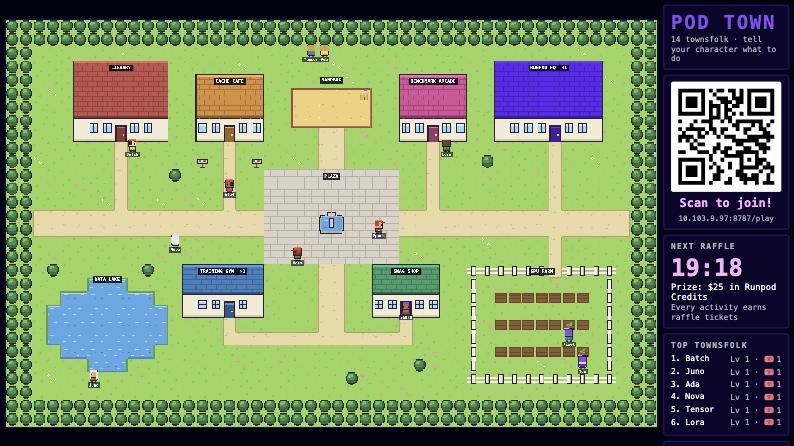
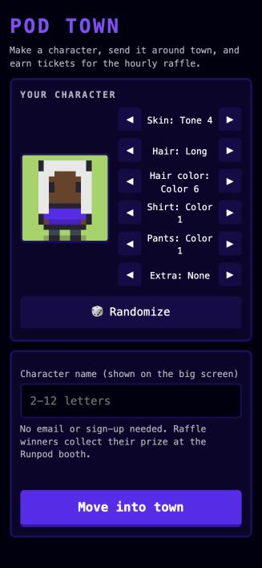

# Pod Town

A booth game for a big screen. Attendees scan a QR code, make a pixel character
on their phone, and tell it what to do ("train a model, then fish for data").
Finished activities earn raffle tickets, and a raffle draws every hour.

Players only choose a character name. No app, sign-up or personal data.

| Big screen | Phone |
| --- | --- |
|  |  |

## Set up for an event

You need a Runpod account with credits (about $1.50 a day) and 10 minutes.
Everything happens in the [Runpod console](https://console.runpod.io).

1. **Deploy a Pod** under Pods: choose **CPU**, the smallest size, and the
   **Pod Town** template. Deploy.
2. **Open the Pod's HTTP service on port 8080** (Connect button). That address,
   `https://<pod-id>-8080.proxy.runpod.net`, is the big screen. The QR code on
   it is the player link.
3. **Open `/admin` straight away and choose the admin password.** Whoever opens
   it first sets the password, so don't leave this for later.
4. **Rehearse:** join from a phone, send your character somewhere, then press
   **Draw a raffle now** on the admin page.

Run one Pod only. To clear rehearsal data, terminate the Pod and deploy again.

**Recommended for multi-day events: add a network volume.** Create one under
Storage (10 GB, same region) and select it when deploying, leaving the mount
path as `/workspace`. Without it, a Pod restart empties the town and resets the
admin password, which you must then choose again at once.

**No Pod Town template?** Under Templates, create one: compute type CPU,
container image `ghcr.io/kilo-loco/pod-town:v1.0.0`, container disk 5 GB, HTTP
port 8080. Leave everything else blank.

Optional settings, as environment variables on the Pod or template:

| Setting | What it does | Default |
| --- | --- | --- |
| `RAFFLE_PRIZE` | Prize text on the screen and phones | `$25 in Runpod Credits` |
| `RAFFLE_WINNERS` | Winners per draw | `1` |
| `RAFFLE_ONE_WIN` | `1` = a character can win only once | `1` |
| `CLAIM_HOURS` | Hours a winner has to collect | `24` |
| `ADMIN_TOKEN` | Fixes the admin password instead of choosing it on the page. Never share or commit it. | Not set |

## On the day

- Put the big screen link in a fullscreen browser and turn off sleep.
- The raffle draws at the top of every hour. The winner's phone shows a
  six-character claim code.
- When a winner comes to the booth, type their code into **Check a claim code**
  on the admin page, hand over the prize, and press **Mark prize given**.
- One person can make several characters, so enforce one prize per person at
  the booth.
- To take an offensive name off the screen, press **Remove** on the admin page.

## After the event

Download the winners CSV from the admin page if you want a record, then
terminate the Pod and delete the volume if you made one. The next event starts
with an empty town.

## Troubleshooting

| Problem | Fix |
| --- | --- |
| Screen says "Connecting" or "Reconnecting" | Check the Pod is running, then wait a minute. |
| "Not found" just after starting | Still starting. Reload in 30 seconds. |
| Town is empty after a restart | The network volume wasn't attached. |
| Forgot the admin password | Terminate the Pod and deploy again (this also clears the town), or set `ADMIN_TOKEN` on the Pod. |
| "Too many wrong passwords" | Wait a minute. The page locks after 10 wrong guesses. |

Prize draws need published terms in many countries. Check with legal per event.

## For developers

Run locally with [Deno](https://deno.com) 2.x: `deno task demo` (30x speed) or
`deno task start`, then open `http://localhost:8080`. Local settings go in
`.env` (copy `.env.example`); `.env` and `data/` are never committed.

Pushing to `main` builds `ghcr.io/<owner>/pod-town:latest` for testing. To
release, push a version tag (`git tag v1.0.1 && git push --tags`) and point the
template's container image at that version. Code: `server.js` (server and APIs), `game/` (map, activities, raffle,
prompt parsing), `public/` (big screen, phone and admin pages).
